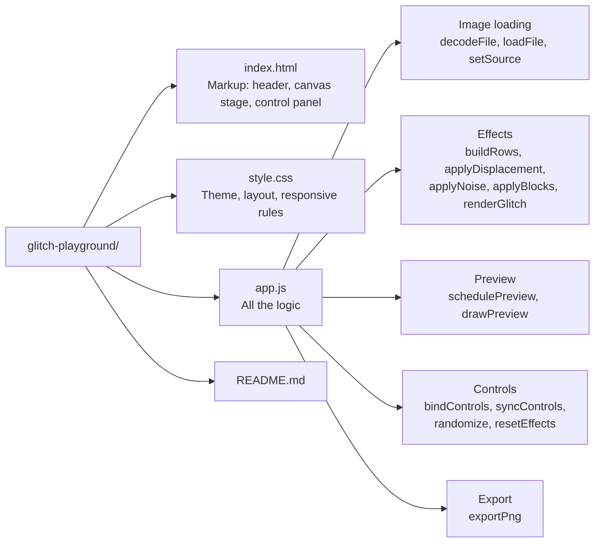
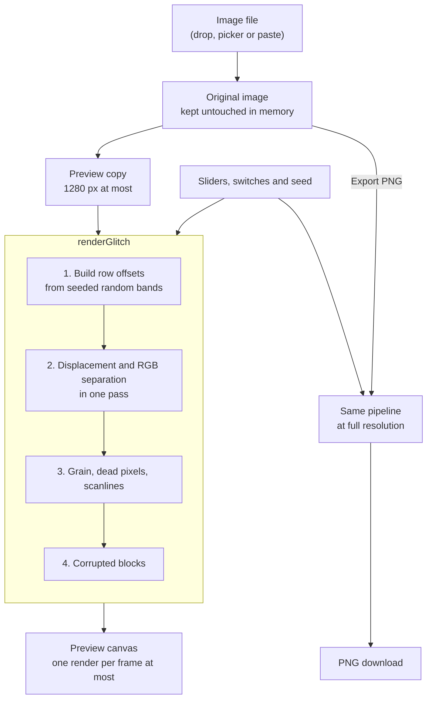

# Glitch/Playground


Turn ordinary images into digital glitch art, directly in the browser.

Built with plain HTML, CSS, JavaScript and the Canvas API. No framework, no build step, no server: images never leave your device.

## Features

- **Local only**: load an image by drag and drop, file picker or paste. Nothing is uploaded.
- **Five controls**: glitch intensity, RGB separation, horizontal displacement, digital noise and glitch frequency.
- **Real-time preview**: every slider updates the canvas immediately.
- **Non-destructive**: each render starts from the original image, so quality never degrades.
- **Per-effect switches**: turn an effect off without losing its setting.
- **Randomize and reset**: get a new look in one click, or go back to the original.
- **Stable patterns**: the glitch comes from a seed, so it stays in place while you adjust it. A new seed gives a new pattern with the same settings.
- **Hold to compare**: see the original image while the button is held.
- **PNG export**: the effects are rendered again at full resolution.
- **Responsive**: works with a mouse or touch, on desktop and mobile.

## Getting started

Open `index.html` in a browser. That is all.

A local server also works if you prefer:

```bash
npx serve .
# or
python -m http.server 8000
```

## How to use it

1. Drop an image on the canvas, click **Select image**, or paste one with `Ctrl+V`. No image at hand? Click **Generate a test pattern**.
2. Move the sliders. Use the switches to turn single effects on or off.
3. Click **Randomize** for a new combination, or **Seed** for a new pattern with the same settings.
4. Click **Export PNG** to download the result as `glitch-playground-YYYYMMDD.png`.

| Control                 | Range    | What it does                                        |
| ----------------------- | -------- | --------------------------------------------------- |
| Glitch intensity        | 0 to 100 | Overall strength. Scales every other effect.        |
| RGB separation          | 0 to 50  | Pulls the red and blue channels apart.              |
| Horizontal displacement | 0 to 100 | Shifts bands of the image sideways.                 |
| Digital noise           | 0 to 100 | Grain, dead pixels, scanlines and corrupted blocks. |
| Glitch frequency        | 0 to 100 | How many bands and artifacts appear.                |

## Project structure



## How it works



A few details behind the diagram:

- **Immutable source.** The imported image is stored once. The preview and the export both read from it and write to a separate buffer, so effects are never applied on top of each other.
- **Displacement.** Bands are picked with a seeded random generator and described as fractions of the image. Each band slides a group of rows left or right, and rows wrap around the edges.
- **RGB separation.** For every pixel, red is read a little to the left and blue a little to the right of the green sample.
- **Noise.** Each pixel gets a value from a hash of its position, which gives grain that is random-looking but identical on every render.
- **Rendering strategy.** Slider events are grouped with `requestAnimationFrame`, so the preview renders once per frame at most, on a reduced copy of the image.
- **Export.** The same pipeline runs on the full-size original. Bands and blocks land in the same places as in the preview.

## Limitations

- Images above 12 megapixels are scaled down once on import. The export size is shown under the canvas.
- Fine grain can look slightly different between the preview and the export, because it is computed again at the export size.
- Only the first frame of an animated GIF is used.
- Supported formats depend on the browser (AVIF and HEIC are not available everywhere).
- A recent version of Chrome, Edge, Firefox or Safari is required.

## Credits

Made by [Kone Issa](https://issa.nocerv.com).

## License

[MIT](LICENSE) © 2026 Kone Issa
